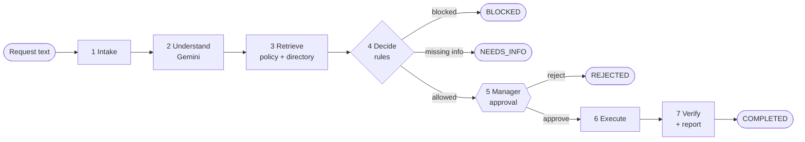

<p align="center"></p>

# Access Request Assistant

An assistant that handles employee access requests written in plain language. It understands the request with Google Gemini, checks it against company policy and the employee directory, waits for the manager's approval, grants the access, and verifies that the grant exists.

> **The LLM suggests, the code decides.** Gemini only turns text into structured fields. Every decision is made by plain, testable rules, and nothing changes without a human approval.

## How it works



1. **Intake** – the input is validated and gets a request ID based on its content.
2. **Understand** – Gemini extracts the system, access level, duration and business reason.
3. **Retrieve** – the matching policy is found and the employee is looked up in the directory.
4. **Decide** – rules check department, level, duration and identity: allowed, missing info, or blocked.
5. **Approve** – the flow stops until the right manager approves the exact plan.
6. **Execute** – the rules are checked again on fresh data, then the access is granted.
7. **Verify** – the directory is read again to confirm the grant; an audit trail and an As-Built report are produced.

## Quick start

Requires Python 3.10+ and a Google Gemini API key.

```bash
pip install -r requirements.txt
cp .env.example .env        # Windows: copy .env.example .env
```

Put your key in `.env`:

```ini
GEMINI_API_KEY=your-key-here
LLM_MODEL=gemini-3.5-flash-lite
```

## Run

| What | Command |
|---|---|
| Demo of all required scenarios + As-Built report | `python demo.py` |
| Same, pausing between scenarios | `python demo.py --pause` |
| Type your own request and approve it yourself | `python -m app interactive` |
| List all scenarios | `python -m app scenario` |
| Run one scenario end to end | `python -m app scenario allow/02_marketing_crm_read_hebrew` |
| Run all scenarios + As-Built report | `python -m app scenario --all` |
| Run the tests | `python -m pytest -v` |

Add `--save-evidence` to `demo.py` or `scenario --all` to copy the report and audit trail to `evidence/`.

Step by step:

```bash
python -m app submit allow/00_happy_path        # stops for approval, prints REQ-<id>
python -m app execute REQ-<id>                   # blocked: no approval yet
python -m app approve REQ-<id> --by u1001        # the manager approves
python -m app execute REQ-<id>                   # grants and verifies -> COMPLETED
python -m app audit   REQ-<id>
```

## Scenarios

`data/scenarios/` holds 36 sample requests, each with the result it must reach. The demo, the CLI and the tests all use this folder. To add a case, add a JSON file to the right folder.

| Folder | Expected result | Examples |
|---|---|---|
| `allow/` (12) | waits for approval, then completes | Hebrew request, "Salesforce" instead of crm, duration in months, no duration, duration above the policy maximum, typos |
| `needs_info/` (7) | asks for missing details | vague request, no business reason, unknown system, not an access request, two requests in one |
| `blocked/` (13) | blocked with a reason | admin access, prompt injection (English and Hebrew), wrong department, level above maximum, disabled or unknown user, no independent approver |
| `invalid/` (4) | rejected before Gemini is called | text too short or too long, bad user ID, missing field |

## Safety

| Risk | Protection |
|---|---|
| Action without approval | Submitting and executing are separate steps; execute requires an approval |
| Wrong approver | Only the employee's direct manager can approve |
| Approving your own request | If the manager submitted it, the manager's own manager must approve |
| Disabled users | A disabled employee cannot receive, request or approve access |
| Plan changed after approval | The approval is tied to a hash of the plan |
| Something changed after approval | The rules are checked again on fresh directory data just before execution |
| Duplicate grants | Same request → same ID; an idempotency key; and "already has this access" is checked again before execution |
| Prompt injection | Request text is treated as data; Gemini can only return fixed values; the decision is made in code |
| Tool or Gemini failure | Limited retries, then a safe stop; nothing is executed |

## Tests

```bash
python -m pytest -v
```

The tests call Gemini, so they need the key in `.env`. Only failures are simulated (tool timeouts, a compromised model, network outages), because they cannot be produced on demand.

| File | What it checks |
|---|---|
| `test_scenarios.py` | every scenario in `data/scenarios/` reaches its expected result |
| `test_flow.py` | approval rules, separation of duties, re-check before execute, tool failures, idempotency, malicious tool parameters |
| `test_llm_providers.py` | Gemini configuration, API errors, safe stop when the service is down |
| `test_config.py` | loading settings from `.env` |

## Project structure

```
app/
  engine.py      runs the 7 steps, the approval gate, retries and verification
  guard.py       the decision rules
  llm.py         Gemini: prompt, JSON output, validation
  tools.py       policy search, directory lookup, grant access
  schemas.py     data contracts (Pydantic)
  state.py       request status and storage (SQLite)
  audit.py       audit trail (JSONL)
  report.py      As-Built HTML report
  scenarios.py   loads scenarios by name
  __main__.py    command line
data/
  directory.json employees, departments, managers
  policies/      5 access policies
  scenarios/     sample requests with expected results
tests/           automated tests
docs/RUNBOOK.md  operation and troubleshooting
demo.py          the scripted demo
```

## Design vs. As-Built

| Given design | As built | Why |
|---|---|---|
| Plan: build a plan and choose the tool | Deterministic rules decide; Gemini is used only to understand the request | Decisions must be predictable, testable and immune to prompt injection |
| Approve: human approval | Bound to the plan hash; the direct manager approves, or the manager's manager if the manager submitted | Approve exactly what is executed; nobody approves their own request |
| Execute: run a tool that changes state | The rules are checked again on fresh data first | Changes after the approval cannot slip through |
| Retrieve: local knowledge | TF-IDF search over 5 policies | Five documents: simple, transparent, no extra services |

## Assumptions and limitations

- The directory and policies are local files that simulate real systems.
- Every grant is time-limited: the policy default if no duration is given, never above the policy maximum.
- Admin access is never granted by the assistant.
- The approver's identity is typed on the command line and not authenticated (production: SSO).
- There is no automatic removal of access when it expires.
- If Gemini maps a request to the wrong system, the rules cannot detect it; the manager sees the exact plan before approving.

## Tools used

Python, Pydantic, Jinja2, SQLite, pytest, and the Google Gemini API (`gemini-3.5-flash-lite`).
Claude (Anthropic) was used to help write parts of the code, tests and documentation; all of it was reviewed, run and adapted.
