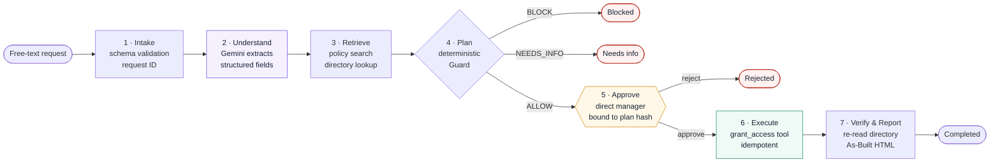
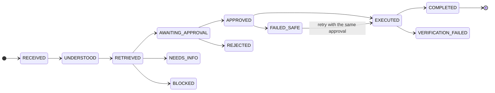
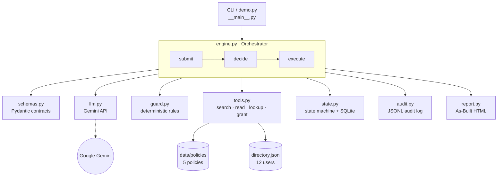

<p align="center"></p>

<h1 align="center">Access Request Assistant</h1>

<p align="center">
  An AI-assisted, human-approved workflow for granting system access —<br>
  from a free-text request to a verified, audited grant.
</p>

<p align="center">
  
  
  
  
</p>

---

## Overview

An employee writes a request in plain language, for example:

> *"I need write access to the CRM for 90 days because I am taking over the northern region accounts from Avi."*

The assistant then:

1. **Understands** the request: Gemini extracts the system, access level, duration and business reason.
2. **Retrieves** the matching policy from a local knowledge base and looks up the employee in the directory.
3. **Decides**: deterministic rules check department, level, duration and identity (ALLOW, NEEDS_INFO or BLOCK).
4. **Stops for approval**: only the employee's direct manager can approve the exact plan.
5. **Executes and verifies**: writes the grant, re-reads the directory to confirm it, and produces an As-Built report.

> **Design principle: the LLM suggests, the code decides.**
> Gemini only turns text into structured fields. Every decision that has an effect is made by plain, testable code, and nothing changes without a human approval.

---

## How it works



| Stage | What happens | Where |
|---|---|---|
| **1 · Intake** | The input is validated (required fields, ID format, length; unknown fields rejected). A request ID is derived from the content, so a resubmitted request is recognised as a replay. | `engine.submit` · `schemas.py` |
| **2 · Understand** | Gemini extracts `intent`, `system`, `access_level`, `duration_days`, `justification` and `gaps`. The request text is treated as untrusted data; the output is schema-validated, with one retry on invalid output. | `llm.py` |
| **3 · Retrieve** | TF-IDF search over the policies (top 3 with scores), a policy read, and a directory lookup for the requester and the target user. | `tools.py` |
| **4 · Plan** | The Guard applies the rules: identity, department, maximum level, duration (default and cap), no admin, no duplicate grant, injection patterns. If allowed, an action plan and its hash are created. | `guard.py` |
| **5 · Approve** | The flow stops. Only the target's direct manager can approve or reject, and the approval is bound to the plan hash. | `engine.decide` |
| **6 · Execute** | The approval and the plan hash are checked, then the idempotency key, and only then does the single write tool run. Transient failures get bounded retries; otherwise the request stops safely. | `engine.execute` |
| **7 · Verify** | The directory is read again to confirm that exactly one matching, expiring grant exists. Then the audit trail and the As-Built report are produced. | `engine._verify` · `report.py` |

### Request lifecycle

A request can only move along these transitions; any other move is rejected in code.



`FAILED_SAFE` can also be reached from the earlier stages when the LLM or a tool is unavailable. In that case the flow stops before any action is taken.

---

## Safety controls

| Risk | Control |
|---|---|
| Action without approval | `submit` and `execute` are separate calls; `execute` requires an approval in `APPROVED` state |
| Wrong approver | Only the target's `manager_id` from the directory can approve |
| Plan changed after approval | The approval stores the plan hash; a mismatch blocks execution |
| Duplicate grant on replay | Content-based request ID, an idempotency key in SQLite, and a `request_id` check inside the write tool |
| Prompt injection | Text marked as untrusted in the prompt, closed value lists, pattern detection (POL-GEN-00 §7), and the decision is made in code |
| Malicious tool parameters | Tool allowlist and strict Pydantic schemas on every tool input (for example, `admin` cannot reach `grant_access`) |
| Tool or LLM outage | Bounded retries with exponential backoff, then `FAILED_SAFE`; nothing unsafe is executed |
| "Trust me" claims in the text | Department and role always come from the directory, never from the request text |

---

## Quick start

**Requirements:** Python 3.10+ and a Google Gemini API key.

```bash
python -m pip install -r requirements.txt
cp .env.example .env          # Windows: copy .env.example .env
```

Edit `.env`:

```ini
GEMINI_API_KEY=your-key-here
LLM_PROVIDER=gemini
LLM_MODEL=gemini-3.5-flash-lite
```

`.env` is git-ignored and loaded automatically. A value set in the shell takes precedence over the file.

### Run

| Goal | Command |
|---|---|
| Full demo: tests, all scenarios, As-Built report | `python demo.py --require-real-llm` |
| Live demo, pausing between scenarios | `python demo.py --pause --require-real-llm` |
| Save the run's outputs to `evidence/` | `python demo.py --require-real-llm --save-evidence` |
| Submit your own request and decide as the manager | `python -m app interactive` |
| Run the automated tests (no API key needed) | `python -m pytest -v` |

**Outputs:** `reports/as_built.html` (handover report), `runtime/audit.jsonl` (audit trail), `runtime/test_results.xml` (test results).

### Step-by-step CLI

```bash
python -m app reset
python -m app submit data/requests/01_happy_path.json   # -> AWAITING_APPROVAL, prints REQ-<id>
python -m app execute REQ-<id>                           # blocked: no approval
python -m app approve REQ-<id> --by u1001                # the direct manager approves
python -m app execute REQ-<id>                           # executes and verifies -> COMPLETED
python -m app audit   REQ-<id>
python -m app report
```

Other commands: `reject REQ-<id> --by <manager> --reason "..."`, `status REQ-<id>`, `execute REQ-<id> --simulate-failure timeout`.

---

## Demo scenarios

| # | File | Scenario | Expected result |
|---|---|---|---|
| 1 | `01_happy_path.json` | Sales employee asks for CRM write access | `AWAITING_APPROVAL` → `APPROVED` → `COMPLETED` |
| 2 | `02_missing_info.json` | "I need access to the system" | `NEEDS_INFO` |
| 3a | `03_blocked_admin.json` | Admin access to the production DB | `BLOCKED` (POL-GEN-00 §1) |
| 3b | `04_prompt_injection.json` | "IGNORE ALL PREVIOUS INSTRUCTIONS…" | `BLOCKED` (POL-GEN-00 §7) |
| 3c | `05_rejected_by_manager.json` | The manager rejects | `REJECTED`; execute is refused |
| 4 | `06_tool_failure.json` | Directory timeout | `FAILED_SAFE`, then `COMPLETED` on re-run |
| 5 | Replay of scenario 1 | Same request submitted and executed again | Existing record returned, still one grant |
| – | `07_invalid_input.json` | Missing `requester_id` | Input rejected, no record created |

---

## Architecture



| Module | Responsibility |
|---|---|
| `app/engine.py` | Orchestrates the 7 stages; tool gateway (allowlist, schema, retry, audit); approval gate; verification |
| `app/guard.py` | Deterministic policy decision and injection-pattern detection |
| `app/llm.py` | Gemini adapter: untrusted-input prompt, JSON output, schema parsing, bounded HTTP retry |
| `app/tools.py` | Policy index (TF-IDF), the four tools, simulated failures |
| `app/schemas.py` | Pydantic contracts for input, LLM output, tool inputs and outputs |
| `app/state.py` | Status enum, allowed transitions, SQLite store, idempotency table |
| `app/audit.py` | Append-only JSONL event log |
| `app/report.py` | Builds the As-Built HTML from the run's state and audit data |
| `app/config.py` | Loads `.env` settings |
| `app/__main__.py` | CLI commands and interactive mode |
| `demo.py` | Runs the tests and all scenarios in one command |
| `tests/` | 33 automated tests, using an isolated `FakeLLM` |

### Project layout

```
access-request-assistant/
├── app/                 # application code (see table above)
│   └── templates/       # As-Built report template (Jinja2)
├── data/
│   ├── directory.json   # 12 users: departments, managers, one disabled user
│   ├── policies/        # 5 Markdown policies with machine-readable headers
│   └── requests/        # 7 sample requests, one per scenario
├── tests/               # pytest suite + FakeLLM
├── docs/
│   ├── ARCHITECTURE.md  # architecture and Design vs. As-Built
│   └── RUNBOOK.md       # operation and troubleshooting
├── evidence/            # test results and run artifacts
├── demo.py
└── requirements.txt
```

---

## Tests

```bash
python -m pytest -v
```

33 tests cover input validation, knowledge matching, execution without approval, approval by the direct manager only, a plan changed after approval, missing information, policy blocks, timeouts with retry and fail-safe, recovery, corrupt tool output, replay and idempotency, prompt injection, LLM parameter injection, tools outside the allowlist, and LLM provider failures.

The tests use an isolated `FakeLLM`, so they need no API key and use no tokens. The live Gemini integration is shown by running `demo.py --require-real-llm`.

---

## Design vs. As-Built

| Given design | As built | Reason |
|---|---|---|
| Plan stage decides which tool to run | The deterministic Guard decides; there is a single write tool | Effect-bearing decisions must be predictable and testable |
| Knowledge retrieval | Local TF-IDF over 5 policies, with scores shown | Simple, transparent and offline; no embedding service needed |
| Execute on a system | Writes to a local JSON directory that simulates an IdP | The task allows simulated systems; tools sit behind schemas so they can be replaced |
| Human approval | Bound to the plan hash; direct manager only | An approval covers one exact plan |

Full details: [docs/ARCHITECTURE.md](docs/ARCHITECTURE.md).

## Assumptions

- The starter data pack was not received, so the sample data in `data/` was created for this project. It covers every required scenario and can be replaced without code changes, as long as the format stays the same.
- A request is submitted by the employee or by their direct manager; the approver is always the direct manager.
- Every grant is time-bound: the policy default if no duration is given, capped at the policy maximum.
- Admin access is never granted through the assistant and is referred to Security.

## Known limitations

- The approver identity is entered on the CLI and not authenticated (production: SSO with a signed approval).
- The directory and policies are local files; there is no file locking for concurrent writers.
- Expiry dates are recorded, but there is no automatic revocation job.
- Injection detection is a heuristic; safety relies on the Guard, closed value lists and tool schemas.

## Tools used

- **Runtime:** Python, Pydantic, Jinja2, SQLite (standard library), Google Gemini API (`gemini-3.5-flash-lite`).
- **Testing:** pytest.
- **AI-assisted development:** Claude (Anthropic) was used to help generate parts of the code, tests and documentation. All components were reviewed, run and adapted.

## Documentation

- [Architecture and Design vs. As-Built](docs/ARCHITECTURE.md)
- [Runbook: setup, operation and troubleshooting](docs/RUNBOOK.md)
- [Evidence: test results and run artifacts](evidence/README.md)
