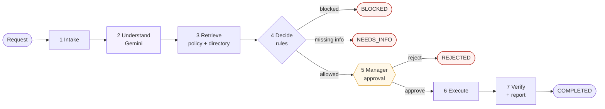
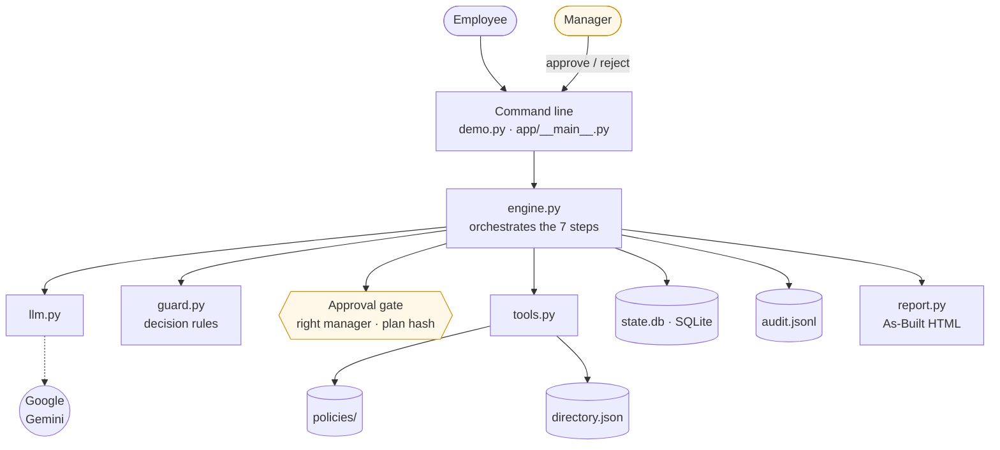

<p align="center"></p>

<p align="center">
  <b>AI-assisted, human-approved access requests — from a sentence to a verified grant.</b>
</p>

<p align="center">
  
  
  
  
</p>

<p align="center">
  <a href="#overview">Overview</a> ·
  <a href="#quick-start">Quick start</a> ·
  <a href="#how-it-works">How it works</a> ·
  <a href="#how-a-decision-is-made">Decisions</a> ·
  <a href="#safety">Safety</a> ·
  <a href="#scenarios-and-tests">Scenarios & tests</a> ·
  <a href="#architecture">Architecture</a> ·
  <a href="#path-to-production">Production</a>
</p>

---

## Overview

An employee writes what they need, in English or Hebrew:

> *"I need write access to the CRM for 90 days because I am taking over the northern region accounts from Avi."*

The assistant then:

1. **understands** the request with Google Gemini,
2. **checks** it against the access policy and the employee directory,
3. **stops** until the employee's manager approves the exact plan,
4. **grants** the access and **verifies** that the grant exists,
5. **records** every step in an audit trail and an As-Built report.

**Design principle — the LLM suggests, the code decides.**
Gemini only turns free text into structured fields. Whether access is allowed is decided by plain, testable rules. Nothing changes without a human approval.

---

## Quick start

**Requirements:** Python 3.10+ and a [Google Gemini API key](https://aistudio.google.com/apikey).

```bash
pip install -r requirements.txt
cp .env.example .env              # Windows: copy .env.example .env
```

Add your key to `.env`:

```ini
GEMINI_API_KEY=your-key-here
LLM_MODEL=gemini-3.5-flash-lite
```

Run the demo:

```bash
python demo.py --pause            # the 5 required scenarios, Enter between them (~1 minute)
python demo.py --pause --replay   # same, offline: recorded Gemini answers, no key or network needed
```

> **No key, or Gemini is down during a live demo?** `--replay` plays back answers that Gemini really gave
> (`data/llm_recordings.json`). It is chosen explicitly and never used as a silent fallback.
> Refresh the recordings with a key: `python -m app record`.

### Commands

| Goal | Command |
|---|---|
| Run the demo + As-Built report | `python demo.py` |
| Same, including the automated tests in the report | `python demo.py --tests` |
| Any command offline, on recorded Gemini answers | `python -m app --replay <command>` · `python demo.py --replay` |
| Record / refresh Gemini answers for replay | `python -m app record` |
| Write your own request and approve it as the manager | `python -m app interactive` |
| List the scenarios | `python -m app scenario` |
| Run one scenario, end to end | `python -m app scenario allow/02_marketing_crm_read_hebrew` |
| Run every scenario + As-Built report | `python -m app scenario --all` |
| Run the automated tests | `python -m pytest -v` |

`--save-evidence` (on `demo.py` or `scenario --all`) copies the report and audit trail to `evidence/`
(with `demo.py --tests`, the test results too).

<details>
<summary><b>Step-by-step commands</b></summary>

```bash
python -m app submit allow/00_happy_path        # stops for approval, prints REQ-<id>
python -m app execute REQ-<id>                   # refused: no approval yet
python -m app approve REQ-<id> --by u1001        # the manager approves
python -m app execute REQ-<id>                   # grants and verifies -> COMPLETED
python -m app status  REQ-<id>
python -m app audit   REQ-<id>
python -m app report                             # writes reports/as_built.html
```

Also available: `reject REQ-<id> --by <id> --reason "..."`, `execute REQ-<id> --simulate-failure timeout`, `reset`.
</details>

### What you will see

```
▶ submit
  Status  : AWAITING_APPROVAL
  Sources : POL-CRM-01 (34.98), POL-FIN-02 (6.91), POL-PROD-03 (4.81)
  ┌─ APPROVAL NEEDED ──────────────────────────────────────────
  │ Grant WRITE access on crm to Noa Mizrahi (u1002, Sales) for 90 days.
  │ risk=medium  policies=POL-GEN-00, POL-CRM-01  approver=u1001
  └────────────────────────────────────────────────────────────
▶ execute before approval   ✗ BLOCKED: no valid approval
▶ approve by u1001          Status: APPROVED
▶ execute → verify          Status: COMPLETED   GRT-c5605e51 crm/write, 90 days
                            Verify: OK (exists · exactly one · system · level · expiry)
```

---

## How it works



| # | Step | What happens | Code |
|---|---|---|---|
| 1 | **Intake** | The input is validated and gets an ID derived from its content, so a repeated request is recognized. | `engine.submit` |
| 2 | **Understand** | Gemini extracts system, access level, duration, reason and gaps. The text is treated as data; the answer must match a schema. | `llm.py` |
| 3 | **Retrieve** | The relevant policies are found and ranked; the requester and the employee are looked up in the directory. | `tools.py` |
| 4 | **Decide** | Rules return *allowed*, *missing info* or *blocked*, with the reason. | `guard.py` |
| 5 | **Approve** | The flow stops. Only the right manager can approve, and only this exact plan. | `engine.decide` |
| 6 | **Execute** | The rules are checked again on fresh data, then the access is granted. | `engine.execute` |
| 7 | **Verify** | The directory is read again to confirm the grant; the audit and the report are written. | `engine._verify` |

---

## How a decision is made

The rules combine three sources. Only one of them comes from the model.

| Source | Provides | Example |
|---|---|---|
| **Gemini** | what was asked | `system: crm`, `access_level: write`, `duration_days: 90`, reason given |
| **Directory** (`data/directory.json`) | who is asking, and what they already have | Noa · Sales · active · manager u1001 · no CRM access |
| **Policy** (`data/policies/*.md`) | what is allowed | CRM: Sales, Support, Marketing · up to `write` · up to 180 days |

The rules then check, among others: department allowed · level not above the maximum · duration within the limit (capped, not rejected) · a business reason exists · no admin · the user is active · the requester is the employee or their manager · the user doesn't already have this access · no instructions to the system in the text.

**Gemini never sees the policies and never decides.** It only receives a short catalog of system names (for example, *crm = Salesforce CRM*) so it can classify the request.

### Policy files

Each policy has a structured header that the rules enforce, and free text used for search and for people:

```yaml
id: POL-CRM-01
title: CRM Access Policy
system: crm                                       # matched to Gemini's answer
allowed_departments: Sales, Support, Marketing    # enforced
max_access_level: write                           # enforced
default_duration_days: 90                         # enforced
max_duration_days: 180                            # enforced
---
# CRM Access Policy (Salesforce CRM)
The CRM holds customer accounts, contacts, deals and pipeline data.   # search + people
```

The general policy (`POL-GEN-00`) applies to every request: no admin through the assistant, who may request, who approves, disabled users, mandatory reason, injection.

---

## Safety

| Risk | Protection |
|---|---|
| Action without approval | `submit` and `execute` are separate steps; `execute` requires a valid approval |
| Wrong approver | Only the employee's direct manager can approve |
| Approving your own request | If the manager submitted it, the manager's own manager approves |
| Disabled users | A disabled user cannot receive, request or approve access |
| Plan changed after approval | The approval is bound to a hash of the plan |
| Changes after approval | The rules are re-checked on fresh directory data just before execution |
| Duplicate grants | Content-based request ID · idempotency key · "already has this access" re-checked before execution |
| Prompt injection | Text treated as data · fixed list of allowed values · decision made in code |
| Claims in the text ("I am the manager") | Identity, department and role always come from the directory |
| Gemini or tool failure | Limited retries (HTTP 429/5xx and timeouts; longer waits on rate limits), then a safe stop — nothing is executed. Submitting the same request again re-runs it |

---

## Scenarios and tests

### Scenarios

`data/scenarios/` contains **36 sample requests**, each with the result it must reach. The demo, the command line and the tests all use this folder; adding a case is adding a JSON file.

| Folder | Expected result | Covers |
|---|---|---|
| `allow/` · 12 | waits for approval, then completes | Hebrew · "Salesforce" instead of crm · months · no duration · over the maximum · typos · manager requesting for an employee |
| `needs_info/` · 7 | asks for the missing details | vague request · no reason · unknown system · not an access request · removal request · two requests in one |
| `blocked/` · 13 | blocked, with the reason | admin · injection (English, Hebrew) · wrong department · level too high · disabled or unknown user · colleague requesting for someone else · no independent approver |
| `invalid/` · 4 | rejected before Gemini is called | text too short or too long · bad user ID · missing field |

```json
{
  "description": "Request written in Hebrew",
  "request": { "requester_id": "u1005", "target_user_id": "u1005",
               "request_text": "אני צריכה הרשאת קריאה למערכת ה-CRM ל-30 יום כדי להכין דוחות קמפיין" },
  "expect":  { "status": "AWAITING_APPROVAL", "system": "crm", "access_level": "read", "duration_days": 30 }
}
```

### Tests

```bash
python -m pytest -v               # 97 tests
```

| Mode | When | What the model answers come from |
|---|---|---|
| **live** | `GEMINI_API_KEY` is set | the Gemini API |
| **replay** | no key, or `TEST_LLM=replay` | answers Gemini really gave, recorded in `data/llm_recordings.json` |

The pytest header shows the mode. In replay mode, a text that has not been recorded is skipped (not passed),
and the 2 tests about the Gemini API itself need live mode.

| File | Checks |
|---|---|
| `test_scenarios.py` | every scenario reaches its expected result; allowed ones are approved, executed and verified |
| `test_guard.py` | every decision rule on its own, with fixed inputs: no model, same result on every run |
| `test_flow.py` | approval rules · separation of duties · re-check before execute · tool failures and recovery · idempotency · malicious tool parameters |
| `test_llm_providers.py` | Gemini configuration · API errors · rate limits · timeouts · replay mode · re-submitting after an outage |
| `test_config.py` | settings loaded from `.env` |

The model is never faked: answers come from Gemini, live or recorded. Only failures are simulated — tool timeouts, a compromised model, a network outage — because they cannot be produced on demand.

---

## Architecture



| Path | Responsibility |
|---|---|
| `app/engine.py` | the 7 steps · tool gateway (allow-list, schema, retries, audit) · approval gate · re-check · verification |
| `app/guard.py` | the decision rules |
| `app/llm.py` | Gemini: prompt, JSON output, validation, retries · replay of recorded answers |
| `app/recordings.py` | records Gemini answers for replay (`python -m app record`) |
| `app/tools.py` | `search_policies` · `read_policy` · `lookup_user` (read) · `grant_access` (write) |
| `app/schemas.py` | data contracts (Pydantic) |
| `app/state.py` | statuses, allowed transitions, SQLite storage |
| `app/audit.py` · `app/report.py` | audit trail · As-Built report |
| `app/scenarios.py` · `app/__main__.py` | scenario loader · command line |
| `data/` | directory · policies · scenarios · recorded Gemini answers |
| `tests/` · `docs/RUNBOOK.md` · `evidence/` | tests · operations guide · run results |

<details>
<summary><b>Requirements coverage</b></summary>

| # | Requirement | Implementation |
|---|---|---|
| 1 | Validated structured input | Pydantic schema; unknown fields rejected; clear error per field |
| 2 | Meaningful LLM use | Gemini extracts and classifies (Hebrew, product names, gaps) |
| 3 | Knowledge retrieval with sources | TF-IDF over 5 policies; top 3 with IDs and scores |
| 4 | Read and write tools | 3 read tools · 1 write tool |
| 5 | State management | SQLite: status, decisions, tool results, approval, final status |
| 6 | Human in the loop | separate `submit` / `execute`; execute needs a valid approval |
| 7 | Input/output schemas | every tool input and output validated |
| 8 | Idempotency | content-based ID · idempotency key · request ID check in the write tool |
| 9 | Error handling | bounded retries with backoff (tools, HTTP 429/5xx, timeouts), then a safe stop; resubmitting re-runs |
| 10 | Post-action verification | directory re-read; 5 checks |
| 11 | Audit trail | every step, tool call, approval and error |
| 12 | HTML As-Built | generated from the run's data |

All five required demo scenarios — happy path, missing info, rejected/blocked, tool failure, replay — run in `python demo.py`.
</details>

<details>
<summary><b>Design vs. As-Built</b></summary>

| Given design | As built | Why |
|---|---|---|
| Plan: build a plan and choose a tool | Rules decide; Gemini only understands | Predictable, testable, immune to injection |
| Approve: human approval | Bound to the plan hash; the manager's manager approves when the manager submitted | Approve exactly what runs; no self-approval |
| Execute: a tool that changes state | Rules re-checked on fresh data first | Changes after the approval cannot slip through |
| Retrieve: local knowledge | TF-IDF over 5 policies | Simple, transparent, no extra services |
| LLM: local or API | Gemini API; an explicit `replay` mode plays back recorded Gemini answers | Demo and tests also work without network or quota, without inventing answers |
| Intake: request ID | Content-based ID; a request stopped by an outage before approval re-runs when resubmitted | A repeat is recognized, yet a temporary outage does not leave a request stuck |
</details>

---

## Path to production

The engine, the rules and the tests stay the same. The edges are replaced:

| Today | In production |
|---|---|
| Command line | Teams, ServiceNow or an internal web portal |
| Typed user IDs | SSO (e.g. Microsoft Entra ID): the signed-in user is the requester or approver |
| `directory.json` | Microsoft Graph: department, manager, status, current access |
| Grant written to a file | Membership in an access group, or the target system's API |
| SQLite · JSONL audit | PostgreSQL · an append-only log in a SIEM |
| API key in `.env` | Vertex AI with an enterprise agreement · secrets in a key vault |
| Expiry recorded only | A scheduled job that removes expired access |

Rollout: recommend-only mode first, then one system with real execution, then more systems. The scenarios run in CI on every change.

---

## Evidence

| File | Contents |
|---|---|
| [`evidence/test_results.xml`](evidence/test_results.xml) | automated test results |
| [`evidence/as_built.html`](evidence/as_built.html) · [`audit.jsonl`](evidence/audit.jsonl) | As-Built report and audit trail of the demo |
| [`evidence/scenarios_as_built.html`](evidence/scenarios_as_built.html) · [`scenarios_audit.jsonl`](evidence/scenarios_audit.jsonl) | the same for all scenarios, expected vs. actual |

Download an `.html` file and open it in a browser to view the report.

## Assumptions and limitations

- The directory and policies are local files that simulate an identity provider and a knowledge base.
- Every grant is time-limited: the policy default when no duration is given, never above the maximum.
- Admin access is never granted by the assistant; it is referred to Security.
- User IDs are typed, not authenticated (production: SSO).
- Expired access is not removed automatically.
- If Gemini classifies a request as the wrong system, the rules cannot detect it; the manager sees the exact plan before approving.
- Injection detection is pattern-based (English and Hebrew) and not complete; the main protection is that the model never decides.
- Replay mode covers only recorded texts; a new text in replay mode stops safely, like an unreachable model.

## Tools used

Python · Pydantic · Jinja2 · SQLite · pytest · Google Gemini API (`gemini-3.5-flash-lite`).
Claude (Anthropic) was used to help write parts of the code, tests and documentation; all of it was reviewed, run and adapted.
