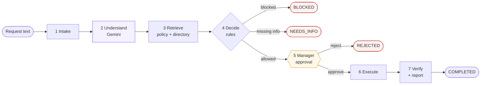
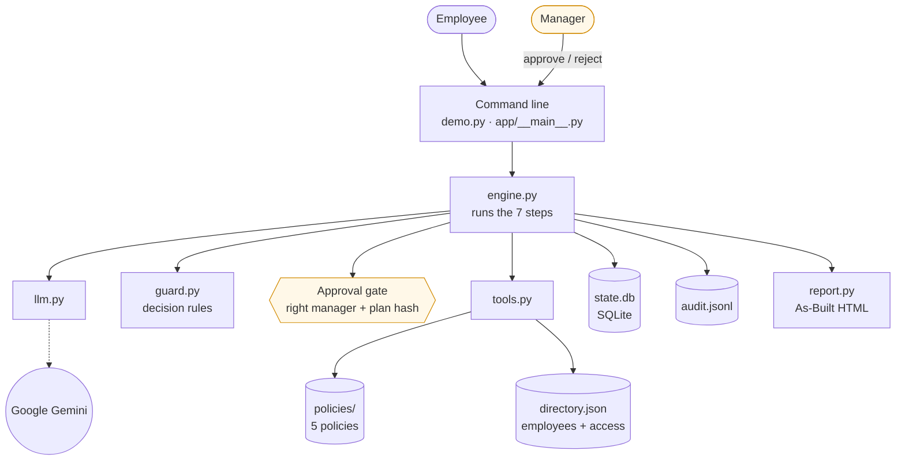

<p align="center"></p>

<p align="center">
  
  
  
  
</p>

# Access Request Assistant

Employees ask for system access in plain language, in English or Hebrew. The assistant understands the request with Google Gemini, checks it against company policy and the employee directory, stops for the manager's approval, grants the access, and verifies that the grant really exists. Every step is recorded.

> **The LLM suggests, the code decides.**
> Gemini only turns text into structured fields. Every decision is made by plain rules that can be tested, and nothing changes without a human approval.

**Contents:** [Example](#example) · [How it works](#how-it-works) · [Quick start](#quick-start) · [Scenarios](#scenarios) · [Requirements coverage](#requirements-coverage) · [Safety](#safety) · [Tests](#tests) · [Architecture](#architecture) · [Evidence](#evidence) · [Limitations](#assumptions-and-limitations)

---

## Example

Noa from Sales writes:

> *I need write access to the CRM for 90 days because I am taking over the northern region accounts from Avi.*

The demo output (shortened):

```
Status  : AWAITING_APPROVAL
Sources : POL-CRM-01 (34.98), POL-FIN-02 (6.91), POL-PROD-03 (4.81)
┌─ APPROVAL NEEDED ──────────────────────────────────────────────
│ Grant WRITE access on crm to Noa Mizrahi (u1002, Sales) for 90 days.
│ tool=grant_access  risk=medium  policies=POL-GEN-00, POL-CRM-01
│ plan_hash=dbbc504f34dea467…  approver=u1001
└────────────────────────────────────────────────────────────────

▶ execute BEFORE approval
  ✗ BLOCKED: cannot execute: status AWAITING_APPROVAL, no valid approval

▶ approve by u1001 (Noa's manager)
  Status  : APPROVED

▶ execute → verify
  Status  : COMPLETED
  Result  : GRT-c5605e51 crm/write, expires in 90 days
  Verify  : OK  grant_exists · exactly_one_grant · system_matches · level_matches · has_expiry
```

---

## How it works



| Step | What happens |
|---|---|
| **1 Intake** | The input is validated; unknown fields are rejected. The request ID comes from the content, so a resubmitted request is recognized. |
| **2 Understand** | Gemini extracts system, access level, duration, reason and gaps. The text is treated as data, and the answer must match a schema. |
| **3 Retrieve** | The best-matching policy is found (with scores), and the requester and employee are looked up in the directory. |
| **4 Decide** | Rules check identity, department, level, duration, admin, duplicates and injection. Result: allowed, missing info, or blocked. |
| **5 Approve** | The flow stops. Only the right manager can approve, and the approval covers the exact plan. |
| **6 Execute** | The rules are checked again on fresh data, then the only write tool runs. Failures are retried a limited number of times, then the flow stops safely. |
| **7 Verify** | The directory is read again to confirm the grant. The audit trail and the As-Built report are produced. |

---

## Quick start

Requires Python 3.10+ and a [Google Gemini API key](https://aistudio.google.com/apikey).

```bash
pip install -r requirements.txt
cp .env.example .env        # Windows: copy .env.example .env
```

Put your key in `.env`:

```ini
GEMINI_API_KEY=your-key-here
LLM_MODEL=gemini-3.5-flash-lite
```

Then run:

| What | Command |
|---|---|
| The demo: all required scenarios + As-Built report | `python demo.py` |
| The demo, pausing between scenarios | `python demo.py --pause` |
| Write your own request and decide as the manager | `python -m app interactive` |
| List all scenarios | `python -m app scenario` |
| Run one scenario, end to end | `python -m app scenario allow/02_marketing_crm_read_hebrew` |
| Run all scenarios + As-Built report | `python -m app scenario --all` |
| Run the tests | `python -m pytest -v` |

Add `--save-evidence` to `demo.py` or `scenario --all` to copy the report and audit trail to `evidence/`.

<details>
<summary><b>Step by step from the command line</b></summary>

```bash
python -m app submit allow/00_happy_path        # stops for approval, prints REQ-<id>
python -m app execute REQ-<id>                   # blocked: no approval yet
python -m app approve REQ-<id> --by u1001        # the manager approves
python -m app execute REQ-<id>                   # grants and verifies -> COMPLETED
python -m app status  REQ-<id>
python -m app audit   REQ-<id>
python -m app report                             # reports/as_built.html
```

Other options: `reject REQ-<id> --by <id> --reason "..."`, `execute REQ-<id> --simulate-failure timeout`, `reset`.
</details>

---

## Scenarios

`data/scenarios/` holds 36 sample requests, each with the result it must reach. The demo, the command line and the tests all use this folder. To add a case, drop a JSON file into the right folder.

| Folder | Expected result | Includes |
|---|---|---|
| `allow/` (12) | waits for approval, then completes | Hebrew text · "Salesforce" instead of crm · duration in months · no duration · above the policy maximum · typos · a manager asking for an employee |
| `needs_info/` (7) | asks for the missing details | vague request · no reason · unknown system (Jira) · not an access request · a removal request · two requests in one |
| `blocked/` (13) | blocked, with the reason | admin · prompt injection in English and Hebrew · wrong department · level above maximum · disabled or unknown user · a colleague asking for someone else · no independent approver |
| `invalid/` (4) | rejected before Gemini is called | text too short or too long · bad user ID · missing field |

```json
{
  "description": "Request written in Hebrew",
  "request": {"requester_id": "u1005", "target_user_id": "u1005",
              "request_text": "אני צריכה הרשאת קריאה למערכת ה-CRM ל-30 יום כדי להכין דוחות קמפיין"},
  "expect": {"status": "AWAITING_APPROVAL", "system": "crm", "access_level": "read", "duration_days": 30}
}
```

---

## Requirements coverage

| # | Requirement | How it is met |
|---|---|---|
| 1 | Structured input with validation | Pydantic schema; unknown fields rejected; clear error per field |
| 2 | Meaningful LLM use | Gemini extracts and classifies the request (Hebrew, product names, gaps) |
| 3 | Knowledge retrieval with sources | TF-IDF over 5 policies; top 3 shown with IDs and scores |
| 4 | At least two tools | `search_policies`, `read_policy`, `lookup_user` (read) · `grant_access` (write) |
| 5 | State management | SQLite: status, decisions, tool results, approval, final status |
| 6 | Human in the loop | `submit` and `execute` are separate; execute needs a valid approval |
| 7 | Input/output schemas | Every tool input and output is validated; `admin` cannot reach the write tool |
| 8 | Idempotency | Content-based request ID · idempotency key in SQLite · request ID check inside the write tool |
| 9 | Error handling | Limited retries with backoff, longer waits for rate limits, then a safe stop |
| 10 | Post-action verification | The directory is read again; 5 checks must pass |
| 11 | Audit trail | Every step, tool call, approval and error in `audit.jsonl` |
| 12 | HTML As-Built | `reports/as_built.html`, generated from the run's data |

All five required demo scenarios (happy path, missing info, rejected/blocked, tool failure, replay) run in `python demo.py`.

---

## Safety

| Risk | Protection |
|---|---|
| Action without approval | Submitting and executing are separate steps; execute needs an approval |
| Wrong approver | Only the employee's direct manager can approve |
| Approving your own request | If the manager submitted the request, the manager's own manager approves |
| Disabled users | A disabled user cannot receive, request or approve access |
| Plan changed after approval | The approval is tied to a hash of the plan |
| Something changed after approval | The rules are checked again on fresh directory data before execution |
| Duplicate grants | Same request → same ID; idempotency key; "already has this access" re-checked before execution |
| Prompt injection | Text treated as data; Gemini can only return fixed values; the decision is made in code |
| Claims in the text ("I am the manager") | Department and role always come from the directory |
| Tool or Gemini failure | Limited retries, then a safe stop; nothing is executed |

---

## Tests

```bash
python -m pytest -v
```

73 tests, run against Gemini (the key must be in `.env`). Only failures are simulated, such as tool timeouts, a compromised model or a network outage, because they cannot be produced on demand.

| File | What it checks |
|---|---|
| `test_scenarios.py` | every scenario in `data/scenarios/` reaches its expected result |
| `test_flow.py` | approval rules, separation of duties, re-check before execute, tool failures and recovery, idempotency, malicious tool parameters |
| `test_llm_providers.py` | Gemini configuration, API errors, rate limits, safe stop when the service is down |
| `test_config.py` | loading settings from `.env` |

---

## Architecture



```
app/
  engine.py      runs the 7 steps: tool gateway, approval gate, re-check, verification
  guard.py       the decision rules
  llm.py         Gemini: prompt, JSON output, validation, retries
  tools.py       policy search, policy read, user lookup, grant access
  schemas.py     data contracts (Pydantic)
  state.py       statuses, allowed transitions, SQLite storage
  audit.py       audit trail (JSONL)
  report.py      As-Built HTML report
  scenarios.py   loads scenarios by name
  __main__.py    command line
data/
  directory.json employees, departments, managers, existing access
  policies/      5 access policies
  scenarios/     36 sample requests with expected results
tests/           automated tests
docs/RUNBOOK.md  operation and troubleshooting
evidence/        test results, audit trails and As-Built reports from runs
demo.py          the scripted demo
```

### Design vs. As-Built

| Given design | As built | Why |
|---|---|---|
| Plan: build a plan and choose a tool | Rules decide; Gemini is used only to understand | Decisions must be predictable, testable and immune to injection |
| Approve: human approval | Bound to the plan hash; the manager's manager approves when the manager submitted | Approve exactly what runs; nobody approves their own request |
| Execute: a tool that changes state | Rules re-checked on fresh data first | Changes after the approval cannot slip through |
| Retrieve: local knowledge | TF-IDF over 5 policies | Simple, transparent, no extra services |

---

## Evidence

| File | Contents |
|---|---|
| [`evidence/test_results.xml`](evidence/test_results.xml) | results of the automated tests |
| [`evidence/as_built.html`](evidence/as_built.html) | As-Built report of the demo run |
| [`evidence/audit.jsonl`](evidence/audit.jsonl) | audit trail of the demo run |
| [`evidence/scenarios_as_built.html`](evidence/scenarios_as_built.html) | As-Built report of all scenarios, expected vs. actual |
| [`evidence/scenarios_audit.jsonl`](evidence/scenarios_audit.jsonl) | audit trail of the scenario run |

To view a report, download the `.html` file and open it in a browser.

---

## Assumptions and limitations

- The directory and policies are local files that simulate real systems (an identity provider and a knowledge base).
- Every grant is time-limited: the policy default if no duration is given, never above the policy maximum.
- Admin access is never granted by the assistant; it goes to Security.
- The approver's identity is typed on the command line and not authenticated (production: SSO).
- Expired access is not removed automatically.
- If Gemini maps a request to the wrong system, the rules cannot detect it; the manager sees the exact plan before approving.

## Tools used

Python, Pydantic, Jinja2, SQLite, pytest, and the Google Gemini API (`gemini-3.5-flash-lite`).
Claude (Anthropic) was used to help write parts of the code, tests and documentation; all of it was reviewed, run and adapted.
