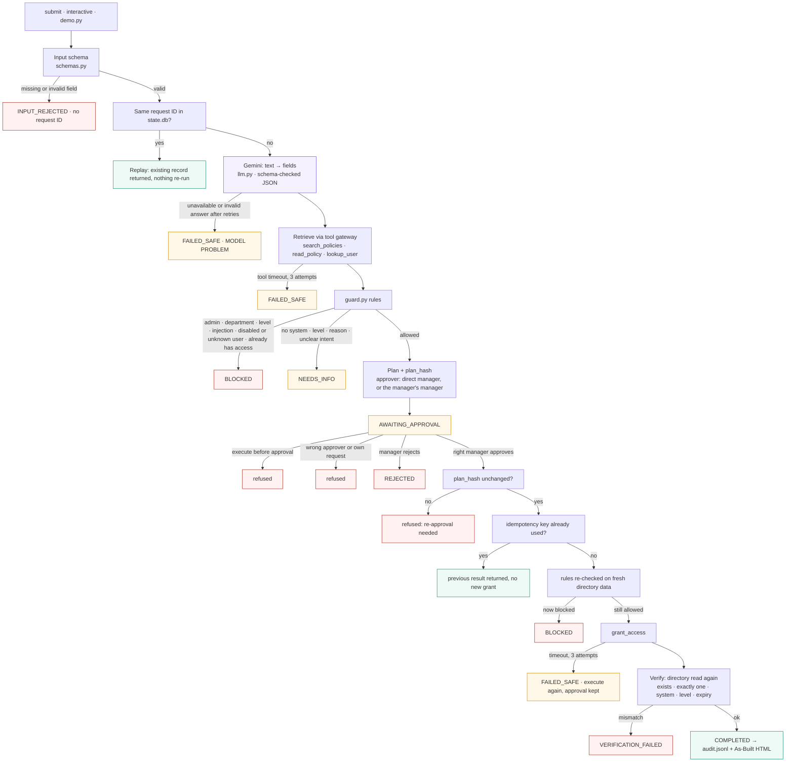
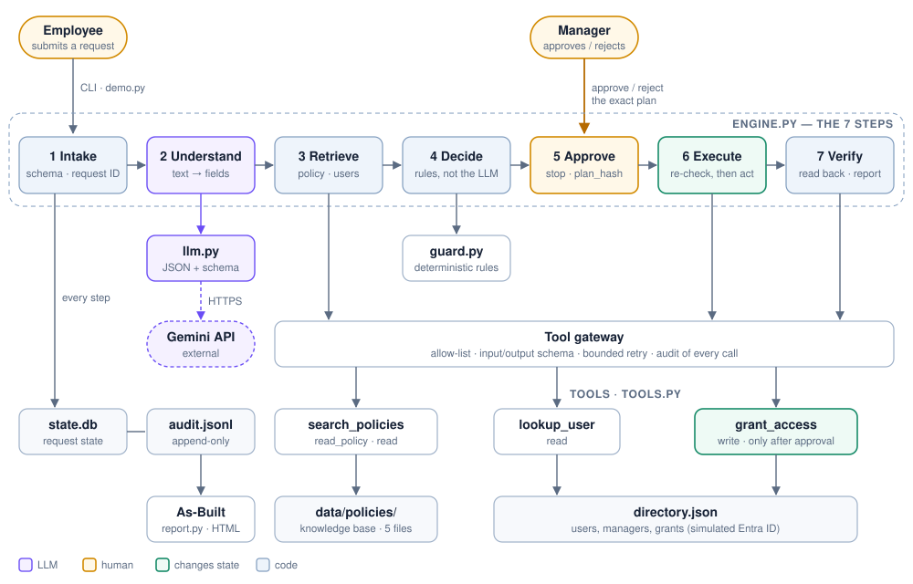

<p align="center"></p>

<p align="center">
  <b>AI-assisted, human-approved access requests — from a sentence to a verified grant.</b>
</p>

<p align="center">
  
  
  
  
</p>

## Overview

An employee writes what they need, in English or Hebrew — *"I need write access to the CRM for 90 days because I am taking over the northern region accounts."* — and the assistant understands it with Google Gemini, checks it against the policies and the directory, waits for the manager to approve the exact plan, grants the access, verifies it and records every step.

**The LLM understands, the code decides, a human approves.** Gemini only turns text into fields; plain, testable rules decide; nothing changes without approval.

## Quick start

Python 3.10+ and a [Gemini API key](https://aistudio.google.com/apikey).

```bash
pip install -r requirements.txt
cp .env.example .env              # then set GEMINI_API_KEY in .env
python demo.py --pause            # the 5 required scenarios + As-Built report
```

| Goal | Command |
|---|---|
| Your own request, approved by you as the manager | `python -m app interactive` |
| One scenario / all scenarios | `python -m app scenario <name>` · `python -m app scenario --all` |
| Tests (against Gemini) | `python -m pytest -v` |
| Clean state | `python -m app reset` |

<details>
<summary><b>Step-by-step commands</b></summary>

```bash
python -m app submit allow/00_happy_path        # stops for approval, prints REQ-<id>
python -m app execute REQ-<id>                   # refused: no approval yet
python -m app approve REQ-<id> --by u1001        # the manager approves
python -m app execute REQ-<id>                   # grants and verifies -> COMPLETED
python -m app status  REQ-<id>
python -m app audit   REQ-<id>
python -m app report                             # writes reports/as_built.html
```

Also available: `reject REQ-<id> --by <id> --reason "..."`, `execute REQ-<id> --simulate-failure timeout`, `reset`.
</details>

## Architecture



<p align="center"></p>

| Path | Responsibility |
|---|---|
| `app/engine.py` | the 7 steps · tool gateway (allow-list, schema, retries, audit) · approval gate · re-check · verification |
| `app/guard.py` | the decision rules |
| `app/llm.py` | Gemini: prompt, JSON output, validation, retries |
| `app/tools.py` | `search_policies` · `read_policy` · `lookup_user` (read) · `grant_access` (write) |
| `app/schemas.py` | data contracts (Pydantic) |
| `app/state.py` | statuses, allowed transitions, SQLite storage |
| `app/audit.py` · `app/report.py` | audit trail · As-Built report |
| `app/scenarios.py` · `app/__main__.py` | scenario loader · command line |
| `data/` | directory · policies · scenarios |
| `tests/` · `docs/RUNBOOK.md` · `evidence/` | tests · operations guide · run results |

## Safety

| Risk | Protection |
|---|---|
| Action without approval | `execute` needs a valid approval by the employee's direct manager — or the manager's manager when the manager submitted (no self-approval) |
| Changes after approval | Approval is bound to a hash of the plan; the rules run again on fresh directory data just before execution |
| Duplicate grants | Content-based request ID · idempotency key · "already has this access" check |
| Prompt injection, claims in the text | Text is data; Gemini returns only fixed values and never sees the policies; identity and role come from the directory; the code decides |
| Disabled users | Cannot receive, request or approve access |
| Gemini or tool failure | Bounded retries, then a safe stop — nothing is executed; when Gemini is down the user sees **MODEL PROBLEM** |

## Scenarios and tests

36 requests in `data/scenarios/`, each with the result it must reach. The demo, the CLI and the tests all use them.

| Folder | Expected result | Covers |
|---|---|---|
| `allow/` · 12 | waits for approval, then completes | Hebrew · "Salesforce" instead of crm · months · no duration · over the maximum · typos · manager requesting for an employee |
| `needs_info/` · 7 | asks for the missing details | vague request · no reason · unknown system · not an access request · removal request · two requests in one |
| `blocked/` · 13 | blocked, with the reason | admin · injection (English, Hebrew) · wrong department · level too high · disabled or unknown user · colleague requesting for someone else · no independent approver |
| `invalid/` · 4 | rejected before Gemini is called | text too short or too long · bad user ID · missing field |

75 tests (`tests/`) run every scenario plus the flow rules: approval, separation of duties, re-check before execute, tool failures, idempotency, malicious tool parameters. The model is never faked; only failures are simulated. Results of the last full run are in [`evidence/`](evidence/).

<details>
<summary><b>Requirements coverage</b></summary>

| # | Requirement | Implementation |
|---|---|---|
| 1 | Validated structured input | Pydantic schema; unknown fields rejected; clear error per field |
| 2 | Meaningful LLM use | Gemini extracts and classifies (Hebrew, product names, gaps) |
| 3 | Knowledge retrieval with sources | TF-IDF over 5 policies; top 3 with IDs and scores |
| 4 | Read and write tools | 3 read tools · 1 write tool |
| 5 | State management | SQLite: status, decisions, tool results, approval, final status |
| 6 | Human in the loop | separate `submit` / `execute`; execute needs a valid approval |
| 7 | Input/output schemas | every tool input and output validated |
| 8 | Idempotency | content-based ID · idempotency key · request ID check in the write tool |
| 9 | Error handling | bounded retries with backoff, then a safe stop; a clear "model problem" message when Gemini is down |
| 10 | Post-action verification | directory re-read; 5 checks |
| 11 | Audit trail | every step, tool call, approval and error |
| 12 | HTML As-Built | generated from the run's data |

All five required demo scenarios — happy path, missing info, rejected/blocked, tool failure, replay — run in `python demo.py`.
</details>

<details>
<summary><b>Design vs. As-Built</b></summary>

| Given design | As built | Why |
|---|---|---|
| Plan: build a plan and choose a tool | Rules decide; Gemini only understands | Predictable, testable, immune to injection |
| Approve: human approval | Bound to the plan hash; the manager's manager approves when the manager submitted | Approve exactly what runs; no self-approval |
| Execute: a tool that changes state | Rules re-checked on fresh data first | Changes after the approval cannot slip through |
| Retrieve: local knowledge | TF-IDF over 5 policies | Simple, transparent, no extra services |
</details>

## Path to production

| Today | In production |
|---|---|
| Command line | Teams, ServiceNow or an internal web portal |
| Typed user IDs | SSO (e.g. Microsoft Entra ID): the signed-in user is the requester or approver |
| `directory.json` | Microsoft Graph: department, manager, status, current access |
| Grant written to a file | Membership in an access group, or the target system's API |
| SQLite · JSONL audit | PostgreSQL · an append-only log in a SIEM |
| API key in `.env` | Vertex AI with an enterprise agreement · secrets in a key vault |
| Expiry recorded only | A scheduled job that removes expired access |

## Limitations

- The directory and policies are local files that simulate an identity provider and a knowledge base.
- Every grant is time-limited: the policy default when no duration is given, never above the maximum.
- Admin access is never granted by the assistant; it is referred to Security.
- User IDs are typed, not authenticated (production: SSO).
- Expired access is not removed automatically.
- If Gemini classifies a request as the wrong system, the rules cannot detect it; the manager sees the exact plan before approving.
- Injection detection is pattern-based (English and Hebrew) and not complete; the main protection is that the model never decides.

## Tools used

Python · Pydantic · Jinja2 · SQLite · pytest · Google Gemini API (`gemini-3.5-flash-lite`).
Claude (Anthropic) was used to help write parts of the code, tests and documentation; all of it was reviewed, run and adapted.
