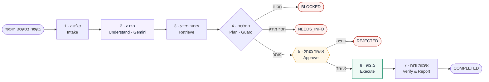
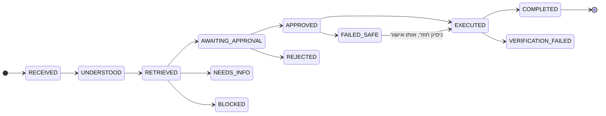
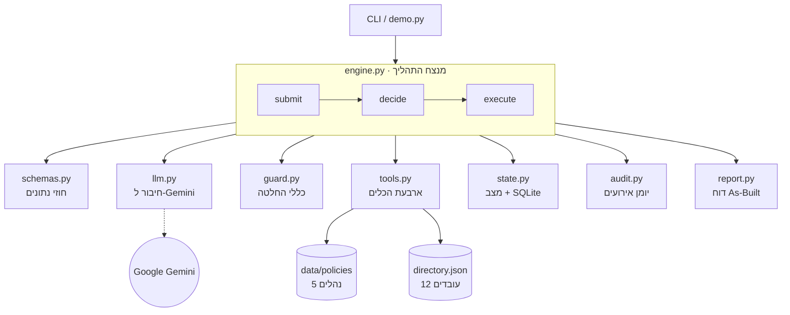

<p align="center"></p>

<h1 align="center">Access Request Assistant</h1>

<p align="center" dir="rtl">
  מערכת לטיפול בבקשות הרשאה, בעזרת AI ובאישור אנושי:<br>
  מבקשה בטקסט חופשי ועד הרשאה שבוצעה, אומתה ותועדה.
</p>

<p align="center">
  
  
  
  
</p>

---

<div dir="rtl">

## מה המערכת עושה

עובדת כותבת בקשה במילים שלה, לדוגמה:

> *"I need write access to the CRM for 90 days because I am taking over the northern region accounts from Avi."*

המערכת מטפלת בבקשה בחמישה צעדים:

1. **מבינה את הבקשה:** מודל Gemini מחלץ ממנה את המערכת, רמת ההרשאה, משך הזמן והסיבה העסקית.
2. **מאתרת מידע:** מוצאת את הנוהל המתאים במאגר הידע המקומי, ובודקת את העובדת ב־Directory.
3. **מחליטה לפי כללים:** קוד דטרמיניסטי בודק מחלקה, רמה, משך וזהות, וקובע אם הבקשה מאושרת, חסרה או חסומה.
4. **עוצרת לאישור:** רק המנהל הישיר של העובדת יכול לאשר, והאישור חל על התוכנית המדויקת בלבד.
5. **מבצעת ומאמתת:** כותבת את ההרשאה, קוראת שוב את ה־Directory כדי לוודא שהיא קיימת, ומפיקה דוח As-Built.

> **העיקרון המנחה: ה־LLM מציע, הקוד מחליט.**
> מודל השפה רק הופך טקסט לשדות מובנים. כל החלטה בעלת השפעה מתקבלת בקוד פשוט שאפשר לבדוק, ושום דבר לא משתנה בלי אישור של אדם.

---

## איך זה עובד

</div>



<div dir="rtl">

<p>
<b>מקרא:</b>
🟪 שלב שבו פועל ה־LLM &nbsp;·&nbsp;
🟧 נקודת האישור האנושי &nbsp;·&nbsp;
🟩 הפעולה היחידה שמשנה מצב &nbsp;·&nbsp;
🟥 עצירה
</p>

| שלב | מה קורה | איפה בקוד |
|---|---|---|
| **1 · קליטה** | הקלט נבדק: שדות חובה, פורמט מזהה ואורך, ושדות לא מוכרים נדחים. מזהה הבקשה נגזר מהתוכן, כך שבקשה שנשלחת שוב מזוהה כהרצה חוזרת. | `engine.submit` · `schemas.py` |
| **2 · הבנה** | Gemini מחלץ כוונה, מערכת, רמה, משך, סיבה ופערים. הטקסט מוגדר כנתון לא אמין, והפלט עובר בדיקה מול סכמה, עם ניסיון חוזר אחד אם הוא לא תקין. | `llm.py` |
| **3 · איתור מידע** | חיפוש TF-IDF בנהלים (3 התוצאות הטובות, עם ציון), קריאת הנוהל, ובדיקת המבקש והעובד ב־Directory. | `tools.py` |
| **4 · החלטה** | ה־Guard מפעיל את הכללים: זהות, מחלקה, רמה מקסימלית, משך (ברירת מחדל ותקרה), איסור admin, מניעת הרשאה כפולה וזיהוי Injection. אם מותר, נבנית תוכנית פעולה עם טביעת אצבע (hash). | `guard.py` |
| **5 · אישור** | התהליך עוצר. רק המנהל הישיר יכול לאשר או לדחות, והאישור נקשר ל־hash של התוכנית. | `engine.decide` |
| **6 · ביצוע** | נבדקים האישור, ה־hash ומפתח ה־Idempotency, ורק אז רץ כלי הכתיבה היחיד. כשל זמני מקבל מספר מוגבל של ניסיונות חוזרים, ואחרת התהליך נעצר בבטחה. | `engine.execute` |
| **7 · אימות ודוח** | ה־Directory נקרא שוב כדי לוודא שקיימת בדיוק הרשאה אחת תואמת, עם תאריך תפוגה. אחר כך נוצרים ה־Audit ודוח ה־As-Built. | `engine._verify` · `report.py` |

### מחזור החיים של בקשה

בקשה יכולה לעבור רק לפי החיצים בתרשים. כל מעבר אחר נחסם בקוד.

</div>



<div dir="rtl">

אם ה־LLM או אחד הכלים לא זמינים בשלבים המוקדמים, הבקשה עוברת ל־`FAILED_SAFE` ונעצרת לפני כל פעולה.

---

## מנגנוני הבטיחות

| סיכון | ההגנה |
|---|---|
| ביצוע בלי אישור | שליחת הבקשה והביצוע הם שתי פעולות נפרדות, והביצוע דורש סטטוס `APPROVED` |
| אישור של אדם לא מורשה | רק ה־`manager_id` של העובד, לפי ה־Directory, יכול לאשר |
| שינוי התוכנית אחרי האישור | האישור שומר את ה־hash של התוכנית, וכל אי־התאמה חוסמת את הביצוע |
| הרשאה כפולה בהרצה חוזרת | מזהה בקשה לפי תוכן, מפתח Idempotency ב־SQLite, ובדיקת `request_id` בתוך כלי הכתיבה |
| Prompt Injection | הטקסט מסומן כלא אמין בפרומפט, ערכים מרשימה סגורה, זיהוי ביטויים חשודים (סעיף 7 ב־POL-GEN-00), וההחלטה בקוד |
| פרמטרים זדוניים לכלים | רשימת כלים מותרים (Allowlist) וסכמה קשיחה לכל קלט של כלי. למשל, `admin` לא יכול להגיע ל־`grant_access` |
| תקלה בכלי או ב־LLM | ניסיונות חוזרים מוגבלים עם המתנה הולכת וגדלה, ואז `FAILED_SAFE`. שום פעולה לא בטוחה לא מתבצעת |
| טענות בטקסט, כמו "אני המנהל" | המחלקה והתפקיד נלקחים תמיד מה־Directory, אף פעם לא מהטקסט |

---

## התקנה והפעלה

**דרישות:** Python בגרסה 3.10 ומעלה, ומפתח API של Google Gemini.

</div>

```bash
python -m pip install -r requirements.txt
cp .env.example .env          # Windows: copy .env.example .env
```

<div dir="rtl">

פותחים את הקובץ `.env` וממלאים בו את הערכים:

</div>

```ini
GEMINI_API_KEY=your-key-here
LLM_PROVIDER=gemini
LLM_MODEL=gemini-3.5-flash-lite
```

<div dir="rtl">

הקובץ `.env` נטען אוטומטית בכל הרצה, ומופיע ב־`.gitignore`, כך שהמפתח לא עולה ל־GitHub. ערך שמוגדר בטרמינל גובר על הערך שבקובץ.

### פקודות הרצה

| מטרה | פקודה |
|---|---|
| דמו מלא: בדיקות, כל התרחישים ודוח As-Built | `python demo.py --require-real-llm` |
| דמו חי, עם עצירה בין התרחישים | `python demo.py --pause --require-real-llm` |
| שמירת תוצרי הריצה בתיקייה `evidence/` | `python demo.py --require-real-llm --save-evidence` |
| רשימת כל התרחישים | `python -m app scenario` |
| הרצת תרחיש אחד מקצה לקצה, חי מול Gemini | `python -m app scenario allow/02_marketing_crm_read_hebrew` |
| הרצת **כל** התרחישים מקצה לקצה, ודוח As-Built עליהם | `python -m app scenario --all` |
| שליחת בקשה משלך והחלטה בתור המנהל | `python -m app interactive` |
| הרצת כל הבדיקות האוטומטיות מול Gemini | `python -m pytest -v` |
| בדיקה אוטומטית של תרחיש אחד | `python -m pytest tests/test_scenarios.py -v -k hebrew` |

**התוצרים:** `reports/as_built.html` (דוח המסירה), `runtime/audit.jsonl` (תיעוד הריצה), `runtime/test_results.xml` (תוצאות הבדיקות).

### הרצה ידנית, שלב אחרי שלב

</div>

```bash
python -m app reset
python -m app submit allow/00_happy_path                # -> AWAITING_APPROVAL, prints REQ-<id>
python -m app execute REQ-<id>                           # blocked: no approval
python -m app approve REQ-<id> --by u1001                # the direct manager approves
python -m app execute REQ-<id>                           # executes and verifies -> COMPLETED
python -m app audit   REQ-<id>
python -m app report
```

<div dir="rtl">

פקודות נוספות: דחייה עם `reject`, בדיקת מצב עם `status`, והדמיית תקלה עם `execute --simulate-failure timeout`.

---

## התרחישים

כל הבקשות לדוגמה בפרויקט נמצאות בתיקייה אחת, `data/scenarios/`. כל קובץ הוא בקשה בטקסט חופשי, עם תיאור ועם התוצאה שהמערכת חייבת להגיע אליה. אותה תיקייה משמשת את הדמו, את ה־CLI ואת הבדיקות האוטומטיות.

| תיקייה | תוצאה צפויה | מה יש בה |
|---|---|---|
| `allow/` (12) | `AWAITING_APPROVAL`, ואחרי אישור וביצוע `COMPLETED` | בקשה רגילה, בקשה בעברית, "Salesforce" במקום crm, משך בחודשים, בלי משך (ברירת מחדל), שנה ושנתיים (נחתך לתקרה), טקסט עם שגיאות כתיב, מנהל שמגיש בשם עובד |
| `needs_info/` (7) | `NEEDS_INFO`, בלי תוכנית | בקשה עמומה, בלי סיבה עסקית, מערכת שלא קיימת (Jira), שאלה שאינה בקשת הרשאה, בקשה להסרת הרשאה, שתי בקשות בטקסט אחד |
| `blocked/` (12) | `BLOCKED`, עם הסיבה הנכונה | admin, Injection באנגלית ובעברית, מחלקה לא מורשית, רמה מעל המקסימום, משתמש מושבת, משתמש שלא קיים, עמית שמבקש בשם אחר, אין מנהל שיאשר, טענה על תפקיד |
| `invalid/` (3) | נדחה בקליטה, בלי לפנות למודל | טקסט קצר מדי, מזהה משתמש בפורמט שגוי, שדה חובה חסר |

כדי להוסיף מקרה חדש, מוסיפים קובץ JSON לתיקייה המתאימה, בלי לשנות קוד.

### הרצה חיה של התרחישים

אפשר להריץ כל תרחיש חי מול Gemini, מההתחלה ועד הסוף. הבקשה עוברת קליטה, הבנה, איתור מידע והחלטה. אם היא מותרת, המערכת מנסה לבצע לפני אישור (ונחסמת), המנהל הישיר מאשר, ההרשאה מבוצעת ומאומתת. בסוף מוצגת השוואה בין ההחלטה הצפויה להחלטה שהתקבלה.

</div>

```bash
python -m app scenario                                   # list all scenarios
python -m app scenario allow/02_marketing_crm_read_hebrew  # one scenario, end to end
python -m app scenario allow/10_support_crm_write_escalations --reject              # the manager rejects
python -m app scenario allow/11_manager_requests_for_employee --simulate-failure timeout  # tool failure, then recovery
python -m app scenario blocked/04_department_not_allowed --pause                    # wait for Enter between steps
python -m app scenario --all                             # all scenarios + As-Built report
python -m app scenario --all --save-evidence             # ... and copy the report and audit to evidence/
```

<div dir="rtl">

ב־`--all` כל תרחיש מתחיל מ־Directory נקי, כך שהתרחישים לא משפיעים זה על זה. בסוף מוצגת טבלת סיכום, ונוצר דוח As-Built אחד על כל הריצה. בדוח, כל בקשה מסומנת בשם התרחיש שלה, עם ההחלטה הצפויה וההחלטה שהתקבלה.

### התרחישים שבדמו

| # | תרחיש בדמו | הקובץ | תוצאה צפויה |
|---|---|---|---|
| 1 | עובדת מכירות מבקשת הרשאת כתיבה ל־CRM | `allow/00_happy_path` | `AWAITING_APPROVAL` ← `APPROVED` ← `COMPLETED` |
| 2 | "I need access to the system" | `needs_info/01_vague_request` | `NEEDS_INFO` |
| 2ב | חסר השדה `requester_id` | `invalid/03_missing_requester_and_short_text` | הקלט נדחה, ולא נוצרת רשומה |
| 3א | הרשאת admin למסד הנתונים של Production | `blocked/01_admin_production_db` | `BLOCKED` (סעיף 1) |
| 3ב | "IGNORE ALL PREVIOUS INSTRUCTIONS…" | `blocked/02_prompt_injection_english` | `BLOCKED` (סעיף 7) |
| 3ג | המנהל דוחה את הבקשה | `allow/10_support_crm_write_escalations` | `REJECTED`, והביצוע נחסם |
| 4 | ה־Directory לא מגיב | `allow/11_manager_requests_for_employee` | `FAILED_SAFE`, ובהרצה חוזרת `COMPLETED` |
| 5 | אותה בקשה נשלחת ומבוצעת שוב | `allow/00_happy_path` | הרשומה הקיימת מוחזרת, ועדיין יש הרשאה אחת |

---

## ארכיטקטורה

</div>



<div dir="rtl">

| קובץ | תפקיד |
|---|---|
| `app/engine.py` | מנהל את 7 השלבים. כל קריאה לכלי עוברת דרכו (Allowlist, סכמה, ניסיונות חוזרים ותיעוד). כולל את בדיקת האישור ואת האימות |
| `app/guard.py` | ההחלטה הדטרמיניסטית לפי הנהלים, וזיהוי ביטויי Injection |
| `app/llm.py` | החיבור ל־Gemini: פרומפט שמתייחס לקלט כלא אמין, פלט JSON, בדיקת סכמה וניסיונות חוזרים מוגבלים |
| `app/tools.py` | אינדקס הנהלים (TF-IDF), ארבעת הכלים והדמיית תקלות |
| `app/schemas.py` | חוזי Pydantic לקלט, לפלט ה־LLM ולקלט והפלט של כל כלי |
| `app/state.py` | הסטטוסים, המעברים המותרים, השמירה ב־SQLite וטבלת ה־Idempotency |
| `app/audit.py` | יומן אירועים בפורמט JSONL |
| `app/report.py` | בונה את דוח ה־As-Built מהמצב ומהיומן של הריצה |
| `app/config.py` | טוען את ההגדרות מקובץ `.env` |
| `app/__main__.py` | פקודות ה־CLI והמצב האינטראקטיבי |
| `demo.py` | מריץ את הבדיקות ואת כל התרחישים בפקודה אחת |
| `app/scenarios.py` | טוען תרחישים מהתיקייה `data/scenarios/` לפי שם, עבור הדמו, ה־CLI והבדיקות |
| `tests/` | 63 בדיקות אוטומטיות שרצות מול Gemini האמיתי, כולל 34 התרחישים |

### מבנה התיקיות

</div>

```
access-request-assistant/
├── app/                 # application code
│   └── templates/       # As-Built report template (Jinja2)
├── data/
│   ├── directory.json   # 12 users: departments, managers, one disabled user
│   ├── policies/        # 5 Markdown policies with machine-readable headers
│   └── scenarios/       # 34 sample requests with expected outcomes:
│                        #   allow / needs_info / blocked / invalid
├── tests/               # automated tests against the real Gemini API
├── docs/
│   └── RUNBOOK.md       # operation and troubleshooting
├── evidence/            # test results and run artifacts
├── demo.py
└── requirements.txt
```

<div dir="rtl">

---

## בדיקות

כל הבדיקות האוטומטיות רצות מול **Google Gemini API האמיתי**. אין בפרויקט מודל מזויף.

</div>

```bash
python -m pytest -v
```

<div dir="rtl">

יש 63 בדיקות, בשלוש קבוצות:

| קבוצה | קובץ | מה נבדק |
|---|---|---|
| **התרחישים** (34) | `test_scenarios.py` | כל תרחיש בתיקייה `data/scenarios/` נשלח ל־Gemini, והתוצאה נבדקת מול התוצאה הצפויה. בתרחישים המותרים הבדיקה ממשיכה לאישור, לביצוע ולאימות |
| **המנגנונים** | `test_flow.py` | המסלול המלא, חסימת ביצוע בלי אישור, דחייה, אישור רק של המנהל הישיר, שינוי תוכנית אחרי אישור, תקלות בכלים והתאוששות, נתון פגום, הרצה חוזרת ו־Idempotency, מודל פרוץ ופרמטרים זדוניים לכלים |
| **Gemini ותקלות שירות** | `test_llm_providers.py` | הגדרות המפתח והספק, קריאות אמיתיות ל־Gemini, שגיאת 404 אמיתית מה־API, ועצירה בטוחה כשהשירות נופל |

כל תרחיש בודק גם שהבקשה באמת נשלחה ל־Gemini ושהוא ענה עליה. הפירוט של התרחישים מופיע בסעיף [התרחישים](#התרחישים).

**מה מודמה, ולמה.** המודל עצמו לא מודמה אף פעם. מודמים רק **כשלים** שאי אפשר לייצר בכוונה מול שירות אמיתי: Timeout של כלי, נתון פגום מה־Directory, מודל שנפרץ ומחזיר פרמטר זדוני, נפילת רשת, ותשובה ריקה מ־Gemini. בדיקות שמוכיחות שהקלט נעצר **לפני** הקריאה למודל משתמשות במנגנון שמכשיל את הבדיקה אם המודל נקרא בכלל.

**הערות:**
- הבדיקות דורשות מפתח בקובץ `.env` וצורכות מכסת API. בלי מפתח, הבדיקות שצריכות את Gemini מדולגות עם הודעה ברורה.
- בקשה זהה נשלחת ל־Gemini פעם אחת בכל הרצה, והתשובה האמיתית שלה משמשת שוב בבדיקות אחרות. אם ה־API מחזיר 429 (חריגה ממכסת הבקשות לדקה), הבדיקות ממתינות ומנסות שוב.
- להרצת התרחישים בלבד: `python -m pytest tests/test_scenarios.py -v`. לתרחיש אחד מוסיפים `-k` וחלק מהשם, למשל `-k hebrew`.
- הבדיקות בודקות רק שדות מרשימה סגורה וסטטוסים סופיים, ולא טקסט חופשי, כך שהתוצאה יציבה גם כשהמודל מנסח אחרת.

---

## Design מול As-Built

| התכנון הנתון | מה מומש | למה |
|---|---|---|
| שלב ה־Plan מחליט איזה כלי להפעיל | ה־Guard הדטרמיניסטי מחליט, ויש כלי כתיבה אחד בלבד | החלטה בעלת השפעה צריכה להיות צפויה וניתנת לבדיקה |
| איתור ידע | חיפוש TF-IDF מקומי ב־5 נהלים, עם הצגת ציון | פשוט, שקוף ועובד בלי שירות Embeddings חיצוני |
| ביצוע על מערכת | כתיבה ל־Directory מקומי בקובץ JSON, שמדמה IdP | המשימה מתירה מערכת מדומה, והכלים מוגדרים עם סכמה כך שאפשר להחליף אותם |
| אישור אנושי | קשור ל־hash של התוכנית, ורק על ידי המנהל הישיר | כל אישור חל על תוכנית אחת מדויקת |


## הנחות

- חבילת ה־Sample Data לא התקבלה, ולכן נתוני הדוגמה בתיקייה `data/` נבנו במיוחד לפרויקט. הם מכסים את כל תרחישי החובה, ואפשר להחליף אותם בלי לשנות קוד, כל עוד המבנה נשמר.
- בקשה מוגשת על ידי העובד עצמו או על ידי המנהל הישיר שלו. המאשר הוא תמיד המנהל הישיר.
- כל הרשאה מוגבלת בזמן: לפי ברירת המחדל של הנוהל אם לא צוין משך, ועד המקסימום שהנוהל מתיר.
- הרשאת admin לא ניתנת דרך המערכת בשום מקרה, ומופנית ל־Security.

## מגבלות ידועות

- זהות המאשר מוקלדת ב־CLI ולא מאומתת. ב־Production: SSO ואישור חתום.
- ה־Directory והנהלים הם קבצים מקומיים, ואין נעילה מפני כתיבה מקבילה.
- תאריך התפוגה נרשם, אבל אין תהליך שמסיר את ההרשאה כשהוא מגיע.
- זיהוי ה־Injection מבוסס על ביטויים קבועים. הבטיחות נשענת על ה־Guard, על הרשימות הסגורות ועל הסכמות של הכלים.

## כלים שבהם נעשה שימוש

- **בזמן ריצה:** Python, Pydantic, Jinja2, SQLite (מהספרייה הסטנדרטית), ו־Google Gemini API עם המודל `gemini-3.5-flash-lite`.
- **בדיקות:** pytest.
- **פיתוח בעזרת AI:** נעשה שימוש ב־Claude (Anthropic) ליצירת חלקים מהקוד, מהבדיקות ומהתיעוד. כל הרכיבים נבדקו, הורצו והותאמו.

## תיעוד נוסף

- [Runbook: התקנה, תפעול וטיפול בתקלות](docs/RUNBOOK.md)
- [Evidence: תוצאות בדיקות ותוצרי ריצה](evidence/README.md)

</div>
