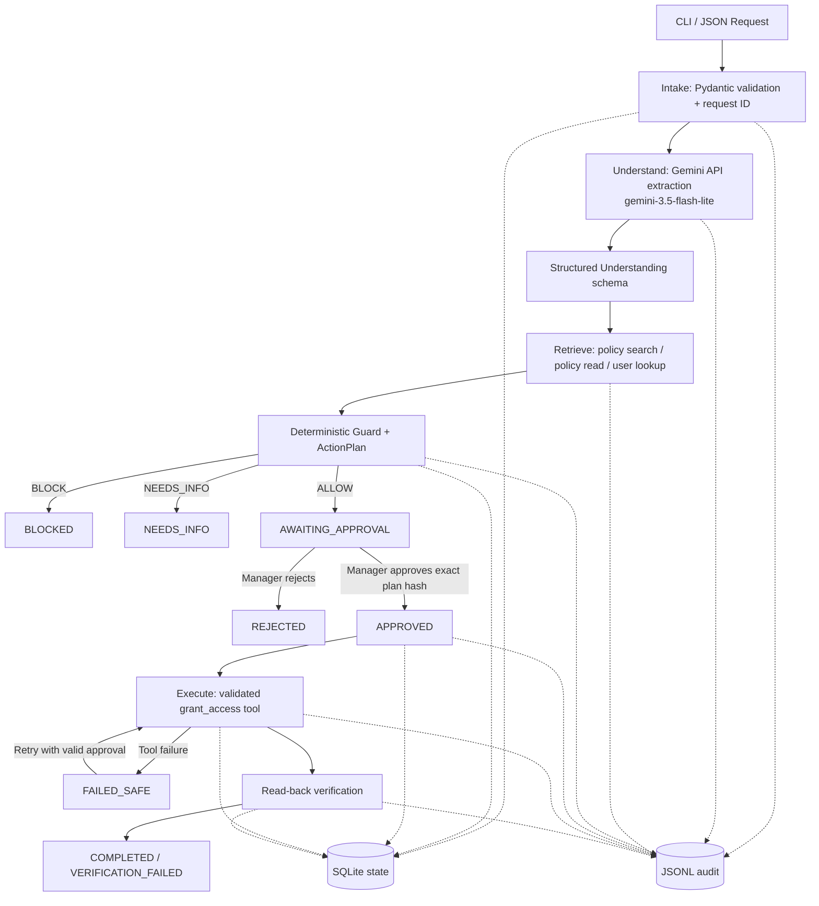

# Access Request Assistant — implemented architecture

## Code map

| Module | Responsibility |
| --- | --- |
| `app/__main__.py` | CLI and interactive demo |
| `app/schemas.py` | Pydantic contracts and input validation |
| `app/llm.py` | Google Gemini API adapter (`gemini-3.5-flash-lite`), bounded HTTP retry, extraction schema parsing |
| `app/tools.py` | Local policy search, read, user lookup, write tool |
| `app/guard.py` | Deterministic policy evaluation, injection heuristics |
| `app/engine.py` | Orchestration, tool allowlist, approval gate, retries, verification |
| `app/state.py` | SQLite-backed state machine and action deduplication |
| `app/audit.py` | JSONL event trail |
| `app/report.py` | HTML As-Built from runtime evidence |
| `demo.py` | End-to-end scripted demonstration |

## Design vs. implementation

- The functional seven-stage flow is retained.
- Plan decision is deterministic rather than an unconstrained LLM decision.
- Approval is bound to the exact `plan_hash`.
- Knowledge retrieval uses local TF-IDF over five Markdown policies, not an embeddings service.
- The write tool updates a local JSON directory, not a real identity provider.
- The CLI manager approval is a simulation and is not authenticated.
- The application has no automatic revocation, no SSO, and no production transaction/locking guarantees.
- Gemini is the only runtime provider; there is no silent fallback. Tests use an isolated FakeLLM (`tests/fake_llm.py`) that the application never loads.
